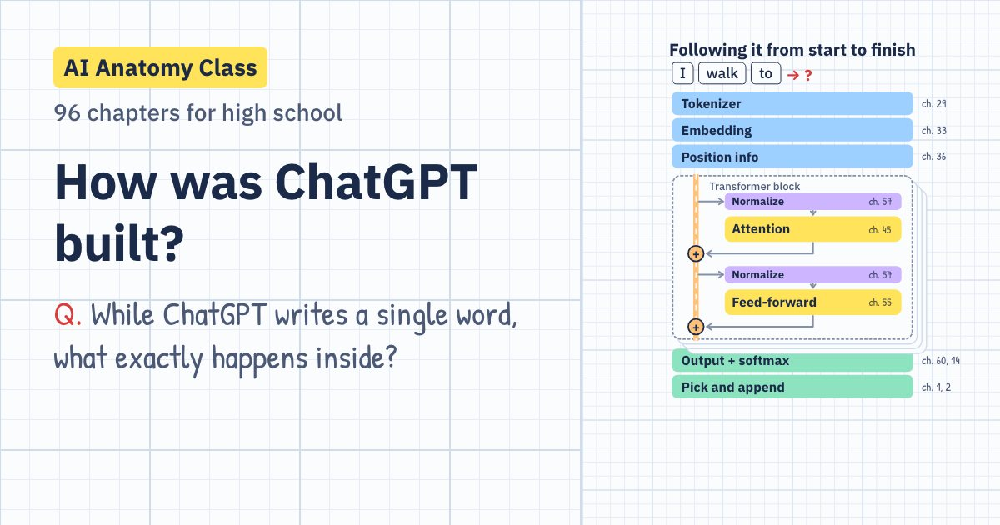

# AI Anatomy Class: the ChatGPT course

[한국어](README.md) · [English](README.en.md) · [日本語](README.ja.md) · [中文](README.zh.md)

**How was ChatGPT built?** A 96-chapter course for high school students that starts with guessing the next word and ends with a transformer you have assembled yourself.

**Open it: https://sangwon9401.github.io/ai-anatomy/en/** (any phone, tablet or computer browser; nothing to install, no sign-in)

Also in [Korean](https://sangwon9401.github.io/ai-anatomy/) (the original), [Japanese](https://sangwon9401.github.io/ai-anatomy/ja/) and [Chinese](https://sangwon9401.github.io/ai-anatomy/zh/). The translations are adaptations: chapters that depend on the language (writing systems, token counts, word order, the proverbs the mini GPT learns from) were rebuilt for each language.



## What a chapter looks like

1. **One question**: "A model's scores can even be negative. How do we turn them into probabilities?"
2. **Animation** on graph paper: step through it scene by scene, or play it through like a video.
3. **Try it**: move sliders, draw digits, train a model.
4. **Chapter summary** and a **three-question red-pen quiz**: a wrong answer takes you back to the scene that explains it.

## What you learn

| Part | Topic | Chapters |
|---|---|---|
| 0 | ChatGPT, who are you? | 1–5 |
| 1 | AI speaks in numbers (vectors, matrices, softmax) | 6–15 |
| 2 | How machines learn (neurons, gradient descent, backpropagation) | 16–27 |
| 3 | Turning text into numbers (tokens, embeddings, position) | 28–36 |
| 4 | Before the transformer (n-grams, RNNs, seq2seq) | 37–43 |
| 5 | Mastering attention (Q·K·V, masks, multi-head) | 44–53 |
| 6 | Assembling the transformer | 54–62 |
| 7 | Teaching GPT: pre-training (scaling) | 63–71 |
| 8 | The birth of ChatGPT (SFT, RLHF) | 72–79 |
| 9 | The moment an answer is made (temperature, hallucination) | 80–85 |
| 10 | The world after ChatGPT (multimodal, RAG, agents) | 86–91 |
| 11 | Graduation project: your own mini GPT | 92–96 |

The math stays at high school level: matrices are used as taught in school, and vectors, exponentials, logarithms and derivatives are shown by intuition first.

## Things that really run

- **Chapter 26, handwritten digits**: a network trained on MNIST recognizes the digit you draw, in your browser (97.97% on the 10,000 test images).
- **Chapters 29–31, tokens**: token counts come from the real OpenAI tokenizers (GPT-3, GPT-4, GPT-4o).
- **Chapter 53, attention maps**: real attention values from running GPT-2 small.
- **Chapter 94, mini GPT**: a real one-block transformer (about 25,000 knobs) that trains inside your phone.

Made-up numbers used for explanation (probabilities, weights and so on) are labeled "illustrative example" on screen. Facts that deserve a second look are listed in [REVIEW.en.md](REVIEW.en.md). If you spot a mistake, please open an issue.

---

## Development

The course plan is in [PLAN.en.md](PLAN.en.md), the rules for making a chapter in [CHAPTER_GUIDE.md](CHAPTER_GUIDE.md), and the translation rules in [I18N_GUIDE.md](I18N_GUIDE.md).

```
app/
  src/data/        chapter specs (narration, quizzes, summaries) and the 96-chapter curriculum
  src/scenes/      Remotion scenes (the in-app player and the MP4 renders share the same code)
  src/playgrounds/ each chapter's "Try it"
  src/ui/          home, chapter page, player, quiz, progress, sharing
  src/remotion/    render entries for MP4s and images (app icon, link-preview cards)
  src/i18n/        English, Japanese and Chinese: only the files that differ, at the same paths as in src/
                   (they replace the Korean files at build time)
  site/og/         link-preview image per chapter (npm run og; per language in site/og/en/ etc.)
  android/         Capacitor 8 Android project
```

### Run

```bash
cd app
npm install
npm run dev              # http://localhost:5173 (Korean)
LOCALE=en npm run dev    # English (also ja, zh)
npm run studio           # edit and preview scenes in Remotion Studio
npm run render -- ch45 out/ch45.mp4   # one chapter as a video (with captions)
LOCALE=en npm run og     # 97 link-preview images → site/og/en/
npm run build:pages      # public website → dist/ (every published language, per-chapter pages, sitemap)
node scripts/i18n-check.mjs en   # find Korean left in the English build
OUT=out/check node scripts/check-scenes.mjs   # render the last frame of every step of all 96 chapters
```

Pushing to `main` makes GitHub Actions build with `build:pages` and deploy to GitHub Pages (`.github/workflows/pages.yml`).

### Android APK

Needs JDK 21 and Android SDK 36 (Homebrew: `openjdk@21`, `android-commandlinetools`). The app currently ships the Korean version.

```bash
cd app
npm run build && npx cap sync android
cd android
JAVA_HOME=/opt/homebrew/opt/openjdk@21 ./gradlew assembleDebug
adb install -r app/build/outputs/apk/debug/app-debug.apk
```

### Notes

- Some screens use `color-mix()`, so Chrome / Android WebView 111+ or Safari 16.2+ is needed.
- Narration plumbing is still in place (`scripts/narrate.mjs`, the scenes' `<Narration>`, `src/data/narration.json`): add natural-sounding voice clips and each scene stretches to fit them.
- Remotion is free for individuals and companies of up to three people; larger companies need a company license.

## License and credits

- **Code**: [Apache License 2.0](LICENSE). Use it freely, commercial use included (keep the [NOTICE](NOTICE)).
- **Course content** (scripts, narration, quizzes, examples, translations, corpora, trained model data, images, documents): [CC BY-NC-SA 4.0](LICENSE-CONTENT.md). With credit, you can use and adapt it **freely for non-commercial purposes** such as teaching a class, study groups or translations. **Selling it or using it in paid courses or academies is not allowed.** [LICENSE-CONTENT.md](LICENSE-CONTENT.md) says exactly what counts as content.

Credits:

- Fonts: IBM Plex Sans / Sans KR / Sans JP, IBM Plex Mono, Noto Sans SC, Gamja Flower, Patrick Hand, Klee One, ZCOOL KuaiLe (SIL Open Font License)
- Handwritten digit data: MNIST (Yann LeCun, Corinna Cortes, Christopher Burges), CC BY-SA 3.0
- Attention data: OpenAI GPT-2 small (MIT License)
- Token counts: OpenAI tiktoken (MIT License)
- Animation: [Remotion](https://www.remotion.dev)
