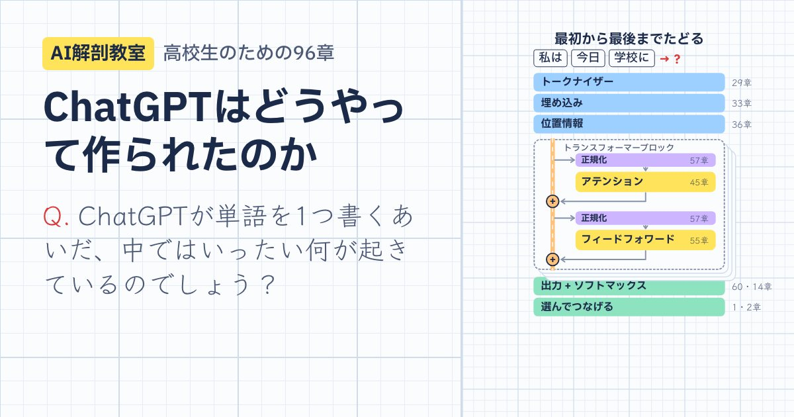

# AI解剖教室：ChatGPT編

[한국어](README.md) · [English](README.en.md) · [日本語](README.ja.md) · [中文](README.zh.md)

**ChatGPTはどうやって作られたのか？** 高校生向けに、「次の言葉当て」から始めて、最後にはトランスフォーマーを自分で組み立てる全96章の講座です。

**今すぐ見る：https://sangwon9401.github.io/ai-anatomy/ja/**（スマホ・タブレット・パソコンのブラウザで。インストールもログインも不要です）

[韓国語](https://sangwon9401.github.io/ai-anatomy/)（オリジナル）、[英語](https://sangwon9401.github.io/ai-anatomy/en/)、[中国語](https://sangwon9401.github.io/ai-anatomy/zh/)版もあります。翻訳しただけではなく、文字のしくみ、トークン数、語順、ミニGPTが学ぶことわざなど、言語によって変わる章はその言語に合わせて作り直しました。



## 1章の流れ

1. **問いをひとつ**：「モデルがつけたスコアはマイナスにもなります。これをどうやって確率にするのでしょう？」
2. **アニメーション**：方眼ノートの上で、1場面ずつ進めるか、動画のように続けて見ます。
3. **やってみよう**：スライダーを動かし、数字を書き、モデルを学習させます。
4. **この章のまとめ**と**赤ペンのクイズ3問**：まちがえると、関係する場面に戻れます。

## 学ぶこと

| Part | 内容 | 章 |
|---|---|---|
| 0 | ChatGPT、きみは誰？ | 1–5 |
| 1 | AIの言葉は数字（ベクトル、行列、ソフトマックス） | 6–15 |
| 2 | 機械はどうやって学ぶのか（ニューロン、勾配降下法、誤差逆伝播法） | 16–27 |
| 3 | 文字を数字に（トークン、埋め込み、位置情報） | 28–36 |
| 4 | トランスフォーマー以前の物語（n-gram、RNN、seq2seq） | 37–43 |
| 5 | アテンション完全攻略（Q・K・V、マスク、マルチヘッド） | 44–53 |
| 6 | トランスフォーマーを組み立てる | 54–62 |
| 7 | GPTに勉強させる：事前学習（スケーリング） | 63–71 |
| 8 | ChatGPTの誕生（SFT、RLHF） | 72–79 |
| 9 | 答えが生まれる瞬間（温度、ハルシネーション） | 80–85 |
| 10 | ChatGPT以後の世界（マルチモーダル、RAG、エージェント） | 86–91 |
| 11 | 卒業プロジェクト：自分だけのミニGPT | 92–96 |

数学は高校生のレベルに合わせています。行列は学校で習ったとおりに使い、ベクトル・指数・対数・微分は、まず直感で見せます。

## 本当に動くもの

- **第26章 手書き数字**：MNISTで学習したニューラルネットが、ブラウザの中であなたの書いた数字を当てます（テスト画像1万枚で正解率97.97%）。
- **第29〜31章 トークン**：実際のOpenAIのトークナイザー（GPT-3、GPT-4、GPT-4o）で数えたトークン数です。
- **第53章 アテンションの地図**：GPT-2 smallを実際に動かして得たアテンションの値です。
- **第94章 ミニGPT**：アテンションブロック1つの本物のトランスフォーマー（つまみ約2.5万個）を、あなたのスマホの中で学習させます。

説明のために作った数字（確率や重みなど）には、画面に「説明用の例」と書いてあります。事実確認がもっと必要なところは [REVIEW.ja.md](REVIEW.ja.md) にまとめました。まちがいを見つけたら、Issue で教えてください。

---

## 開発

企画書は [PLAN.ja.md](PLAN.ja.md)、章を作るルールは [CHAPTER_GUIDE.md](CHAPTER_GUIDE.md)、翻訳のルールは [I18N_GUIDE.md](I18N_GUIDE.md)（どちらも英語）にあります。

```
app/
  src/data/        章の仕様（ナレーション・クイズ・まとめ）と96章のカリキュラム
  src/scenes/      Remotionの場面（アプリのプレーヤーとMP4レンダーが同じコードを使う）
  src/playgrounds/ 各章の「やってみよう」
  src/ui/          ホーム、章のページ、プレーヤー、クイズ、進み具合の保存、シェア
  src/remotion/    MP4と画像のレンダー用エントリー（アプリアイコン、リンクプレビューのカード）
  src/i18n/        英語・日本語・中国語版：src/ と同じパスに、変わるファイルだけを置く
                   （ビルド時に韓国語のファイルと入れ替わる）
  site/og/         章ごとのリンクプレビュー画像（npm run og、言語別に site/og/ja/ など）
  android/         Capacitor 8 の Android プロジェクト
```

### 実行

```bash
cd app
npm install
npm run dev              # http://localhost:5173（韓国語）
LOCALE=ja npm run dev    # 日本語版（en、zh も同じ）
npm run studio           # Remotion Studio で場面を編集・プレビュー
npm run render -- ch45 out/ch45.mp4   # 1章を動画に（字幕つき）
LOCALE=ja npm run og     # リンクプレビュー画像97枚 → site/og/ja/
npm run build:pages      # 公開ウェブサイト → dist/（公開中のすべての言語、章ごとのページ、sitemap）
node scripts/i18n-check.mjs ja   # 日本語版に残った韓国語を探す
OUT=out/check node scripts/check-scenes.mjs   # 全96章のすべてのステップの最後の場面をレンダー
```

`main` ブランチに push すると、GitHub Actions が `build:pages` でビルドして GitHub Pages に公開します（`.github/workflows/pages.yml`）。

### Android APK

JDK 21 と Android SDK 36 が必要です（Homebrew：`openjdk@21`、`android-commandlinetools`）。アプリには今のところ韓国語版が入っています。

```bash
cd app
npm run build && npx cap sync android
cd android
JAVA_HOME=/opt/homebrew/opt/openjdk@21 ./gradlew assembleDebug
adb install -r app/build/outputs/apk/debug/app-debug.apk
```

### メモ

- `color-mix()` を使う画面があるため、Chrome / Android WebView 111 以上、Safari 16.2 以上が必要です。
- ナレーションのしくみ（`scripts/narrate.mjs`、場面の `<Narration>`、`src/data/narration.json`）は残してあります。自然な音声ファイルを入れれば、場面の長さが音声に合わせて伸びます。
- Remotion は個人と3人以下の会社なら無料です。それより大きい会社には会社ライセンスが必要です。

## 著作権と出典

© 2026 sangwon9401. コードと講座コンテンツのすべての権利は著作者にあります。**商用利用はどんな形でも禁止です。** サイトで学ぶこと、コードを読むこと、リンクを共有することは自由ですが、それ以外の複製・改変・再配布は、非商用でも許可が必要です。詳しい条件は [LICENSE](LICENSE)（日本語訳：[LICENSE.ja.md](LICENSE.ja.md)）をご覧ください。

- フォント：IBM Plex Sans / Sans KR / Sans JP、IBM Plex Mono、Noto Sans SC、Gamja Flower、Patrick Hand、Klee One、ZCOOL KuaiLe（SIL Open Font License）
- 手書き数字データ：MNIST（Yann LeCun、Corinna Cortes、Christopher Burges）
- アテンションデータ：OpenAI GPT-2 small（MIT License）
- トークン数の計算：OpenAI tiktoken（MIT License）
- アニメーション：[Remotion](https://www.remotion.dev)
