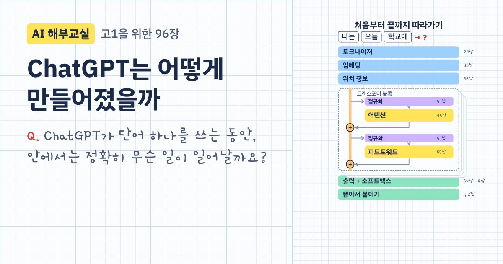

# AI 해부교실: ChatGPT편

**ChatGPT는 어떻게 만들어졌을까?** 고등학교 1학년 눈높이로, 다음 말 맞히기에서 시작해 트랜스포머를 끝까지 조립하는 96장짜리 강의예요.

**바로 보기: https://sangwon9401.github.io/ai-anatomy/** (휴대폰, 태블릿, PC 브라우저 어디서나. 설치도 로그인도 필요 없어요)



## 한 장은 이렇게 생겼어요

1. **질문 하나**: "모델이 매긴 점수는 음수도 되는데, 이걸 어떻게 확률로 바꿀까요?"
2. **애니메이션**: 모눈 공책 위에서 한 장면씩 넘기거나, 영상처럼 이어서 봐요.
3. **직접 해보기**: 슬라이더를 움직이고, 숫자를 그리고, 모델을 학습시켜요.
4. **한 장 요약**과 **빨간펜 퀴즈 3문제**: 틀리면 관련 장면으로 돌아가요.

## 무엇을 배우나

| Part | 내용 | 장 |
|---|---|---|
| 0 | ChatGPT, 넌 누구니? | 1–5 |
| 1 | AI의 언어는 숫자 (벡터, 행렬, 소프트맥스) | 6–15 |
| 2 | 기계는 어떻게 배우나 (뉴런, 경사하강법, 역전파) | 16–27 |
| 3 | 글자를 숫자로 (토큰, 임베딩, 위치 정보) | 28–36 |
| 4 | 트랜스포머 이전 이야기 (n-gram, RNN, seq2seq) | 37–43 |
| 5 | 어텐션 완전 정복 (Q·K·V, 마스크, 멀티헤드) | 44–53 |
| 6 | 트랜스포머 조립하기 | 54–62 |
| 7 | GPT 공부시키기 (사전학습, 스케일링) | 63–71 |
| 8 | ChatGPT의 탄생 (SFT, RLHF) | 72–79 |
| 9 | 대답이 만들어지는 순간 (온도, 환각) | 80–85 |
| 10 | ChatGPT 이후의 세계 (멀티모달, RAG, 에이전트) | 86–91 |
| 11 | 졸업 프로젝트: 나만의 미니 GPT | 92–96 |

수학은 2022 개정 교육과정 고1 수준에 맞췄어요. 행렬은 공통수학1에서 배운 그대로 쓰고, 벡터·지수·로그·미분은 직관으로 먼저 보여 줘요.

## 진짜로 돌아가는 것들

- **26장 손글씨 숫자**: MNIST로 학습한 신경망이 브라우저에서 내가 그린 숫자를 맞혀요 (시험 이미지 1만 장 정답률 97.97%).
- **29~31장 토큰**: 실제 OpenAI 토크나이저(GPT-3, GPT-4, GPT-4o)로 센 토큰 수예요.
- **53장 어텐션 지도**: GPT-2 small을 실제로 돌려 얻은 어텐션 값이에요.
- **94장 미니 GPT**: 어텐션 블록 하나짜리 진짜 트랜스포머(손잡이 약 2.4만 개)를 내 폰 안에서 학습시켜요. 갤럭시 S24에서 2,000걸음에 약 36초.

설명을 위해 지어낸 숫자(확률, 가중치 등)에는 화면에 "설명용 예시"라고 적혀 있어요. 사실 확인이 더 필요한 부분은 [REVIEW.md](REVIEW.md)에 모아 두었어요. 틀린 곳을 발견하면 이슈로 알려 주세요.

---

## 개발

기획서는 [PLAN.md](PLAN.md), 장을 만드는 규칙은 [CHAPTER_GUIDE.md](CHAPTER_GUIDE.md)에 있어요.

```
app/
  src/data/        장 스펙(내레이션·퀴즈·요약)과 커리큘럼 96장 목록
  src/scenes/      Remotion 장면 (앱의 플레이어와 MP4 렌더가 같은 코드를 씀)
  src/playgrounds/ 장마다 "직접 해보기"
  src/ui/          홈, 장 페이지, 플레이어, 퀴즈, 진도 저장, 공유
  src/remotion/    MP4·이미지 렌더용 엔트리 (앱 아이콘, 공유 미리보기 카드)
  site/og/         장마다 공유 미리보기 이미지 (npm run og로 다시 만듦)
  android/         Capacitor 8 Android 프로젝트
```

### 실행

```bash
cd app
npm install
npm run dev              # http://localhost:5173
npm run studio           # Remotion Studio에서 장면 편집·미리보기
npm run render -- ch45 out/ch45.mp4   # 한 장을 영상으로 (자막 포함)
npm run og               # 공유 미리보기 이미지 97장 → site/og/
npm run build:pages      # 공개 웹사이트 → dist/ (장마다 공유용 페이지, sitemap 포함)
OUT=out/check node scripts/check-scenes.mjs   # 96장 모든 스텝의 끝 장면 렌더 (오류·멈춤 검사)
```

`main` 브랜치에 올리면 GitHub Actions가 `build:pages`로 빌드해 GitHub Pages에 배포해요 (`.github/workflows/pages.yml`).

### Android APK

JDK 21과 Android SDK 36이 필요해요 (Homebrew: `openjdk@21`, `android-commandlinetools`).

```bash
cd app
npm run build && npx cap sync android
cd android
JAVA_HOME=/opt/homebrew/opt/openjdk@21 ./gradlew assembleDebug
adb install -r app/build/outputs/apk/debug/app-debug.apk
```

- 폰의 뒤로가기 버튼은 `@capacitor/app`으로 받아요. 장에서 누르면 목차(방금 본 장 위치)로, 목차에서 누르면 앱을 닫아요.
- 앱 안의 공유 버튼은 `@capacitor/share`로 폰의 공유창을 열고, 웹사이트의 그 장 주소를 보내요.
- 아이콘과 스플래시는 `src/remotion/AppIcon.tsx`를 렌더해서 만들었어요.

### 새 장 추가

1. `src/data/chNN.ts`에 스펙 작성. 장면에 그리는 글자는 전부 `labels`에 넣어야 렌더할 때 한글 폰트가 빠지지 않아요.
2. `src/scenes/ChNNScene.tsx` 작성. 애니메이션은 `useCurrentFrame()` + `beat()`로만 만들어요.
3. Part 2~11은 `src/scenes/parts/partN.ts`와 `src/playgrounds/partN/index.ts`에 등록해요.
4. `node scripts/stills.mjs --part N chNN:ends`로 각 스텝의 마지막 장면을 렌더해서 확인해요.

### 메모

- `color-mix()`를 쓰는 화면이 있어서 Chrome / Android WebView 111 이상, Safari 16.2 이상이 필요해요.
- 내레이션 연결 부분(`scripts/narrate.mjs`, 장면의 `<Narration>`, `src/data/narration.json`)은 남아 있어요. 자연스러운 TTS로 음성 파일만 넣으면 장면 길이가 음성에 맞춰 늘어나요.
- Remotion은 개인이나 3인 이하 회사는 무료예요. 그보다 큰 회사는 회사 라이선스가 필요해요.

## 저작권과 출처

© 2026 sangwon9401. 코드와 강의 콘텐츠의 모든 권리는 저작자에게 있어요. 보고 배우는 건 자유지만, 허락 없이 복제하거나 다른 곳에 배포할 수는 없어요.

- 폰트: IBM Plex Sans KR, IBM Plex Mono, Gamja Flower (SIL Open Font License)
- 손글씨 숫자 데이터: MNIST (Yann LeCun, Corinna Cortes, Christopher Burges)
- 어텐션 데이터: OpenAI GPT-2 small (MIT License)
- 토큰 수 계산: OpenAI tiktoken (MIT License)
- 애니메이션: [Remotion](https://www.remotion.dev)
