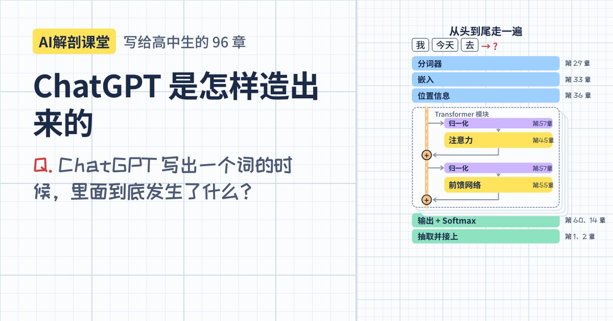

# AI解剖课堂：ChatGPT 篇

[한국어](README.md) · [English](README.en.md) · [日本語](README.ja.md) · [中文](README.zh.md)

**ChatGPT 是怎样造出来的？** 这是一门写给高中生的 96 章课程：从猜下一个词开始，最后亲手组装出一个 Transformer。

**马上打开：https://sangwon9401.github.io/ai-anatomy/zh/**（手机、平板、电脑浏览器都能用，不用安装，也不用登录）

还有[韩文版](https://sangwon9401.github.io/ai-anatomy/)（原版）、[英文版](https://sangwon9401.github.io/ai-anatomy/en/)和[日文版](https://sangwon9401.github.io/ai-anatomy/ja/)。各版本不只是翻译：文字系统、词元数量、语序、迷你 GPT 学习的谚语等随语言而变的章节，都按各自的语言重新制作了。



## 一章是这样的

1. **一个问题**：“模型打的分数还可能是负数，怎样把它变成概率？”
2. **动画**：在方格本上一步一步看，或者像视频一样连续播放。
3. **动手试试**：拖动滑块、写数字、训练模型。
4. **本章小结**和**红笔小测验 3 道题**：答错了可以回到讲解它的画面。

## 学什么

| Part | 内容 | 章节 |
|---|---|---|
| 0 | ChatGPT，你是谁？ | 1–5 |
| 1 | AI 的语言是数字（向量、矩阵、Softmax） | 6–15 |
| 2 | 机器是怎样学习的（神经元、梯度下降、反向传播） | 16–27 |
| 3 | 把文字变成数字（词元、嵌入、位置信息） | 28–36 |
| 4 | Transformer 之前的故事（n-gram、RNN、seq2seq） | 37–43 |
| 5 | 彻底搞懂注意力（Q·K·V、掩码、多头） | 44–53 |
| 6 | 组装 Transformer | 54–62 |
| 7 | 让 GPT 学习：预训练（规模定律） | 63–71 |
| 8 | ChatGPT 的诞生（SFT、RLHF） | 72–79 |
| 9 | 回答诞生的瞬间（温度、幻觉） | 80–85 |
| 10 | ChatGPT 之后的世界（多模态、RAG、智能体） | 86–91 |
| 11 | 毕业项目：属于自己的迷你 GPT | 92–96 |

数学保持在高中水平：先用直觉展示向量、指数、对数和导数，再给出公式。

## 真的能运行的东西

- **第 26 章 手写数字**：用 MNIST 训练的神经网络在浏览器里认出你写的数字（1 万张测试图片正确率 97.97%）。
- **第 29～31 章 词元**：词元数量来自真实的 OpenAI 分词器（GPT-3、GPT-4、GPT-4o）。
- **第 53 章 注意力地图**：实际运行 GPT-2 small 得到的注意力数值。
- **第 94 章 迷你 GPT**：只有一个注意力模块的真正 Transformer（约 3 万个旋钮），在你的手机里训练。

为了讲解而编的数字（概率、权重等）在画面上都标着“示意数据”。还需要核实的内容整理在 [REVIEW.zh.md](REVIEW.zh.md)。发现错误请通过 Issue 告诉我们。

---

## 开发

课程规划见 [PLAN.zh.md](PLAN.zh.md)，制作章节的规则见 [CHAPTER_GUIDE.md](CHAPTER_GUIDE.md)，翻译规则见 [I18N_GUIDE.md](I18N_GUIDE.md)（后两者为英文）。

```
app/
  src/data/        章节规格（旁白、测验、小结）和 96 章课程表
  src/scenes/      Remotion 画面（应用里的播放器和 MP4 渲染共用同一套代码）
  src/playgrounds/ 每章的“动手试试”
  src/ui/          首页、章节页、播放器、测验、学习进度、分享
  src/remotion/    MP4 和图片的渲染入口（应用图标、链接预览卡片）
  src/i18n/        英文、日文、中文版：只放有变化的文件，路径与 src/ 相同
                   （构建时替换对应的韩文文件）
  site/og/         每章的链接预览图（npm run og，各语言在 site/og/zh/ 等）
  android/         Capacitor 8 Android 项目
```

### 运行

```bash
cd app
npm install
npm run dev              # http://localhost:5173（韩文）
LOCALE=zh npm run dev    # 中文版（en、ja 同理）
npm run studio           # 在 Remotion Studio 里编辑、预览画面
npm run render -- ch45 out/ch45.mp4   # 把一章渲染成视频（带字幕）
LOCALE=zh npm run og     # 97 张链接预览图 → site/og/zh/
npm run build:pages      # 公开网站 → dist/（所有已发布语言、每章独立页面、sitemap）
node scripts/i18n-check.mjs zh   # 查找中文版里残留的韩文
OUT=out/check node scripts/check-scenes.mjs   # 渲染全部 96 章每一步的最后一帧
```

推送到 `main` 分支后，GitHub Actions 会用 `build:pages` 构建并发布到 GitHub Pages（`.github/workflows/pages.yml`）。

### Android APK

需要 JDK 21 和 Android SDK 36（Homebrew：`openjdk@21`、`android-commandlinetools`）。应用目前内置的是韩文版。

```bash
cd app
npm run build && npx cap sync android
cd android
JAVA_HOME=/opt/homebrew/opt/openjdk@21 ./gradlew assembleDebug
adb install -r app/build/outputs/apk/debug/app-debug.apk
```

### 备注

- 部分画面用到 `color-mix()`，需要 Chrome / Android WebView 111 以上或 Safari 16.2 以上。
- 旁白相关代码（`scripts/narrate.mjs`、画面里的 `<Narration>`、`src/data/narration.json`）仍保留着：放入自然的语音文件后，画面长度会自动配合语音延长。
- Remotion 对个人和 3 人以下的公司免费；更大的公司需要公司许可。

## 许可与出处

- **代码**：[Apache License 2.0](LICENSE)。可以自由使用，包括商业用途（请保留 [NOTICE](NOTICE)）。
- **课程内容**（脚本、旁白、测验、示例、译文、语料、训练好的模型数据、图片、文档）：[CC BY-NC-SA 4.0](LICENSE-CONTENT.zh.md)。注明出处后，可以**以非商业方式自由**使用和改编，例如课堂教学、学习小组、翻译。**不得出售，也不得用于付费课程、培训班等商业用途。**哪些属于课程内容，见 [LICENSE-CONTENT.zh.md](LICENSE-CONTENT.zh.md)。

出处：

- 字体：IBM Plex Sans / Sans KR / Sans JP、IBM Plex Mono、Noto Sans SC、Gamja Flower、Patrick Hand、Klee One、ZCOOL KuaiLe（SIL Open Font License）
- 手写数字数据：MNIST（Yann LeCun、Corinna Cortes、Christopher Burges）、CC BY-SA 3.0
- 注意力数据：OpenAI GPT-2 small（MIT License）
- 词元计数：OpenAI tiktoken（MIT License）
- 动画：[Remotion](https://www.remotion.dev)
